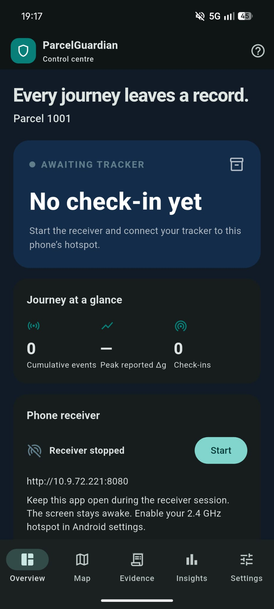
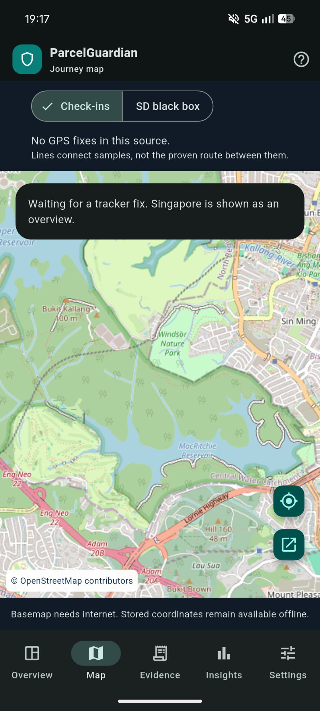
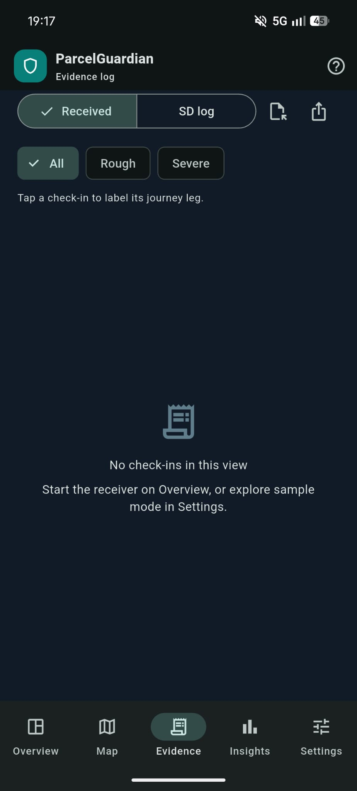
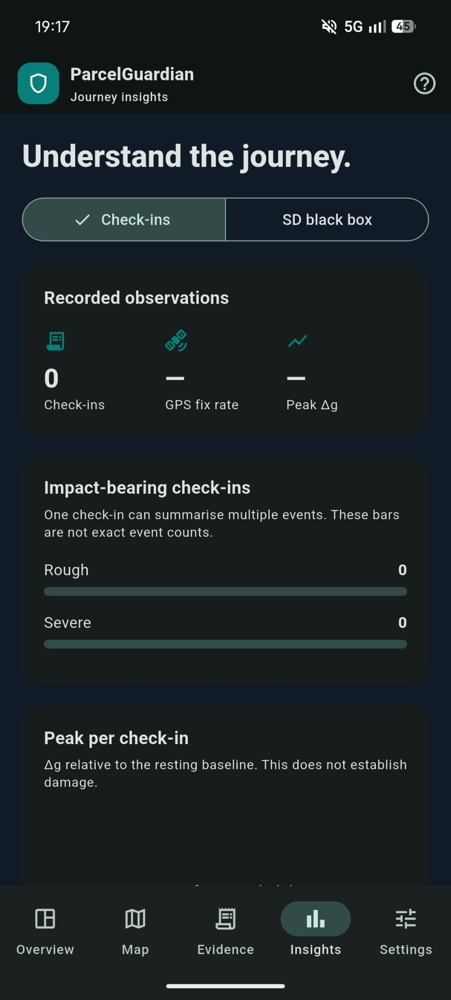
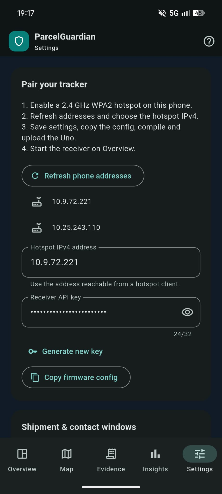

# ParcelGuardian

**A parcel black box with an Android control centre.** Built for EP0402
Fundamentals of IoT, Group 6, using an Arduino Uno R3 and the supplied wireless
tracker shield.

ParcelGuardian detects rough handling, sounds a local alert, and records events
and GPS readings to microSD. An Android phone acts as both the **Wi-Fi hotspot
and local server**, receiving check-ins whenever the tracker can connect.

**The SD card is the system of record.** Phone history contains the check-ins
that arrived. An optional HTTPS relay copies those check-ins to ThingSpeak.

## Downloads

| Download | Contents |
|---|---|
| [Android APK](https://github.com/MilkmanAbi/EP0402-FIOT-GRP6-Project/releases/download/v1.0.0/ParcelGuardian-Android-v1.0.0.apk) | Installable control centre for Android 7.0 or newer |
| [Arduino ZIP](https://github.com/MilkmanAbi/EP0402-FIOT-GRP6-Project/releases/download/v1.0.0/ParcelGuardian-Arduino-v1.0.0.zip) | Main sketch, bench-test sketches, configuration example, build helper and hardware documentation |
| [Checksums](https://github.com/MilkmanAbi/EP0402-FIOT-GRP6-Project/releases/download/v1.0.0/SHA256SUMS.txt) | SHA-256 hashes of the release downloads |

See the [release page](https://github.com/MilkmanAbi/EP0402-FIOT-GRP6-Project/releases/tag/v1.0.0)
for release notes. The APK is signed for personal/classroom sideloading. It uses
the same signing certificate as the initial test APK. No Play Store account or
USB debugging is needed to install the downloaded APK through a file manager.

## App preview

<p align="center">
  
</p>

Screenshots from a **CMF Phone 2 Pro running Nothing OS 4.3**. They show the app
before receiving tracker data. The map's initial Singapore view is an overview,
not a reported parcel location.

<details>
<summary>View the map, evidence, insights and settings gallery</summary>

### Journey map and evidence log

<p>
  
  
</p>

### Journey insights and pairing settings

<p>
  
  
</p>

</details>

## What it does

| Function | Implementation |
|---|---|
| Detect | ADXL345 acceleration magnitude, calibrated at rest, with rough/severe thresholds and debounce |
| Alert | Local buzzer and shield LED, with a silent mode for bench work |
| Record | SD event and heartbeat rows, including when Wi-Fi is unavailable |
| Report | ESP-01 AT firmware sends check-ins to the phone on TCP port 8080 |
| Review | Android timeline, severity filters, journey-leg labels, SD CSV import and CSV export |
| Map | Recorded GPS fixes, impact markers, sampled route lines and Google Maps handoff |
| Analyse | Fix rate, peak acceleration, reported severity, contact gaps and labelled journey legs |
| Flag silence | App-side LIVE, QUIET and LOST states from the time since the last accepted check-in |

LOST means **no contact beyond the chosen threshold**. It does not prove theft,
damage or destruction. A valid check-in without GPS still counts as contact.

## How it connects

```text
ADXL345 + NEO-6M GPS
         │
    Arduino Uno ───────→ microSD: recorded events and breadcrumbs
         │
       ESP-01
         │  2.4 GHz Wi-Fi, local HTTP
         ▼
   Android phone: hotspot + ParcelGuardian receiver (:8080)
         │
         └── optional HTTPS relay ──→ private ThingSpeak channel
```

There is no separate PC server. Local reception works without internet. Map
tiles and the optional cloud relay need the phone's internet connection.

## Quick start

### 1. Prepare the phone

1. Install the [Android APK](https://github.com/MilkmanAbi/EP0402-FIOT-GRP6-Project/releases/download/v1.0.0/ParcelGuardian-Android-v1.0.0.apk).
2. Enable a **2.4 GHz WPA2** hotspot in Android Settings.
3. Open ParcelGuardian → **Settings** → **Refresh phone addresses**. Choose the
   hotspot-side IPv4 address, save settings, then **Copy firmware config**.

Hotspot addresses vary by phone and may change after a restart. Verify the
selected address from a connected client; do not assume `192.168.43.1` or copy
an address from the screenshots. See [phone setup](docs/PHONE_SETUP.md).

### 2. Prepare the Arduino

Extract the Arduino ZIP, or clone this repository:

```powershell
git clone https://github.com/MilkmanAbi/EP0402-FIOT-GRP6-Project.git
cd EP0402-FIOT-GRP6-Project
```

Install Arduino AVR Boards and the Arduino **SD** library. Copy
`arduino/ParcelGuardian/Secrets.example.h` to `Secrets.h`, then enter the actual
hotspot SSID/password, selected phone address, matching API key and shipment ID.
Keep `Secrets.h` private; it is gitignored and excluded from release archives.

With Arduino CLI:

```powershell
arduino-cli core install arduino:avr
arduino-cli lib install SD
Copy-Item arduino/ParcelGuardian/Secrets.example.h arduino/ParcelGuardian/Secrets.h
# Edit Secrets.h before uploading.
arduino-cli compile --fqbn arduino:avr:uno --warnings all arduino/ParcelGuardian
arduino-cli board list
arduino-cli upload --fqbn arduino:avr:uno --port COM_PORT arduino/ParcelGuardian
```

Replace `COM_PORT` with the actual Uno port. In Arduino IDE, open
`arduino/ParcelGuardian/ParcelGuardian.ino`, select **Arduino Uno**, choose the
port, and upload. Serial Monitor runs at **9600 baud**.

Run the independent [bench tests](arduino/tools) before relying on the combined
sketch: **EspAtTest**, **GpsRawTest**, **SdCardTest** and **AdxlDropTest**.

### 3. Receive check-ins

Press **Start** on the app's Overview screen and **keep the app open**. The
receiver session keeps the display awake; background/screen-off reception is
not guaranteed.

From a client connected to the hotspot, check `http://PHONE_IP:8080/health`.
It should return `ParcelGuardian receiver`. The Uno must use the same address,
pairing key and shipment ID. GPS requires outdoor sky view; an indoor no-fix
check-in should appear honestly without a current position.

At handover, use console `d` or READOUT mode to export the SD log, or read
`PGLOG.CSV` from the card. Import it on **Evidence**. SD imports remain separate
from phone check-ins and never refresh the contact clock.

## Repository layout

```text
arduino/
  ParcelGuardian/       Main Uno sketch and modules
  tools/                Four independent bench-test sketches
  README.md             Arduino setup and configuration
app/
  lib/                  Flutter screens, receiver and persistence
  android/              Android project and Gradle wrapper
  test/                 Protocol, journal and layout tests
docs/
  images/               Five named screenshots from the physical phone
  CALIBRATION.md        Physical threshold-calibration worksheet
  PHONE_SETUP.md        Hotspot pairing and handover instructions
  PROTOCOL.md           Request, acknowledgement and data-source rules
  TESTING.md            Measured checks and outstanding hardware tests
  AUDIT.md              Firmware findings, fixes and review scope
tests/arduino/          Native regression harness with mocked hardware
tools/                  Build and release-packaging scripts
```

## Shield connections

| Function | Uno pins |
|---|---|
| ADXL345 SDA / SCL | A4 / A5 |
| microSD MISO / MOSI / SCK / CS | D12 / D11 / D13 / D10 |
| Buzzer / shield LED | D9 / D8 |
| DIP switches | D7 / D6 |
| GPS receive / transmit | D4 / D5, `SoftwareSerial(4,5)` |
| ESP-01 receive / transmit | D2 / D3, `SoftwareSerial(2,3)` |

Pin directions are from the Uno's perspective. D13 is SPI clock, so use the
shield LED on D8. Verify the shield's regulation and level shifting: ESP-01 is
a **3.3 V** device and needs AT firmware configured for **9600 baud**.

## Detection and operating modes

The firmware samples acceleration magnitude at 20 Hz and compares it with the
resting baseline. Default thresholds are **0.40 g rough**, **1.20 g severe**,
with **2 seconds debounce**. These are starting values; fill in the
[calibration worksheet](docs/CALIBRATION.md) using the actual mounted parcel.
The algorithm does not establish damage or validated fall detection.

| Logical D7 / D6 | Mode | Behaviour |
|---|---|---|
| 0 / 0 | NORMAL | 30-second SD heartbeat, 20-second upload |
| 0 / 1 | DEMO | 5-second heartbeat, 10-second phone upload |
| 1 / 0 | SILENT | Normal timings with buzzer muted |
| 1 / 1 | READOUT | Stop tracking and print the SD record |

Verify switch polarity with console `m`; configure `DIP_ACTIVE_LOW` if needed.
The app defaults to **QUIET after 20 seconds** and **LOST after 60 seconds** for
the demo. Both thresholds are configurable.

Console commands: `?` help, `s` status, `r` RAM, `m` mode, `c` recalibrate,
`b` buzzer, `l` LED, `u` upload, `g` GPS, `a` arrived, `d` dump,
`w` erase SD log and `z` reset event counters. The app does not remotely invoke
the destructive wipe/reset commands.

## Building and verification

The recorded toolchain is Flutter **3.47.9**, Dart **3.13.7**, Arduino CLI
**1.3.1**, Arduino AVR Boards **1.8.8** and SD **1.3.0**. Android builds require
the Android SDK and JDK 17 or a compatible supported JDK.

```powershell
# Arduino main sketch and all bench tests
./tools/build-arduino.ps1

# Android app
cd app
flutter pub get
flutter analyze
flutter test
flutter build apk --release
```

The APK is written to `app/build/app/outputs/flutter-apk/app-release.apk`.
`tools/build.ps1` runs both sets of builds and app checks. Native Arduino
regressions run with `tests/arduino/run.cmd` on Windows with MSVC installed.

The default Uno build has measured **31,790 bytes flash / 1,274 bytes global
RAM**, with no Arduino compiler warnings. All four bench sketches compile.
Eleven Flutter tests and the native GPS/EEPROM/ESP regression harness pass.
Emulator checks cover live HTTP reception, authentication, duplicate handling,
maps, SD import and CSV export. The app also launches on the physical CMF phone
shown above. See [verification details](docs/TESTING.md) for the distinction
between software checks and outstanding physical tracker tests.

## Optional ThingSpeak relay

Create a private channel with these fields, then enable the app's HTTPS relay
and enter its write key:

| Field | Value |
|---|---|
| 1 | Latitude; blank without a fix |
| 2 | Longitude; blank without a fix |
| 3 | Peak delta-g since the previous successful device upload |
| 4 | Status: 0 normal, 1 rough, 2 severe, 3 no fix |
| 5 | Cumulative event count |

The phone relays one queued check-in every 20 seconds while open. Local
acknowledgement does not depend on cloud availability. The retained legacy
direct-ThingSpeak route uses `UPLINK_PHONE=0` and a 20-second upload cadence.

## Limits

Only one SoftwareSerial port receives at a time, so GPS characters are lost
during ESP work. SD, EEPROM and UART operations still introduce sampling gaps;
brief shocks may be missed. SD flushing cannot guarantee survival of abrupt
power loss or filesystem corruption. Automatic replay of offline SD rows is
not implemented; import the card at handover.

The Uno-to-phone connection uses local HTTP. Its pairing key authenticates
requests but does not encrypt traffic or sign the evidence. This is a classroom
prototype. Physical calibration, shield power checks, actual hotspot-to-ESP
operation and cloud acceptance must be verified on the real hardware.

Further reading: [Arduino guide](arduino/README.md), [phone setup](docs/PHONE_SETUP.md),
[protocol](docs/PROTOCOL.md), [security](docs/SECURITY.md), [audit](docs/AUDIT.md),
and [original design](docs/ORIGINAL_DESIGN.md).
